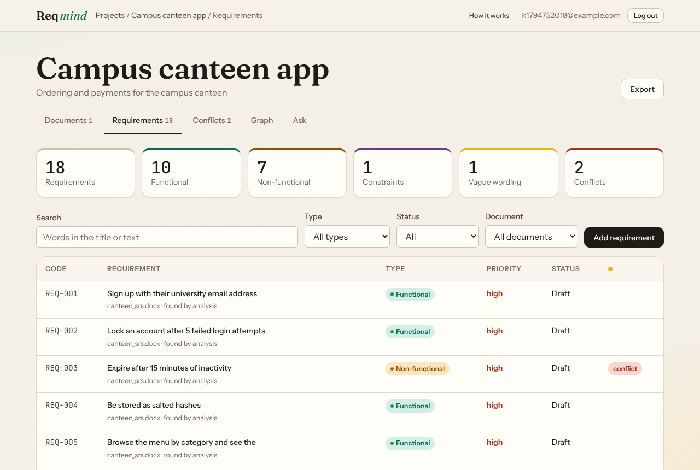
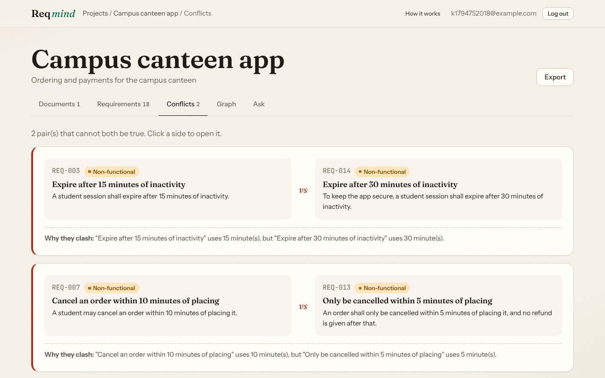
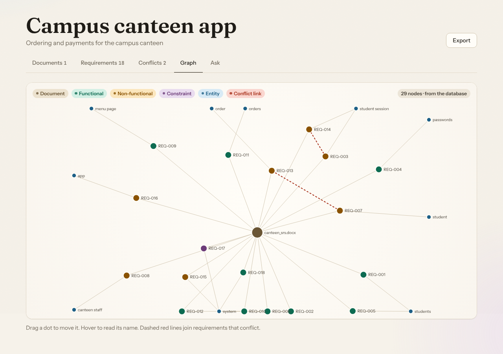
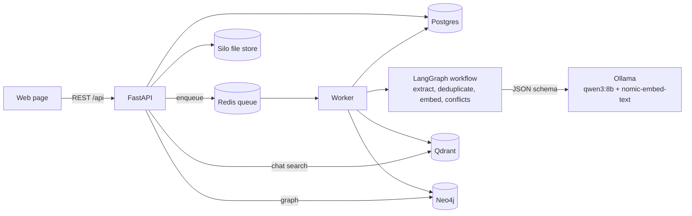

# ReqMind AI

Upload a software requirements document and get back a clean list of requirements, the pairs that contradict each other, a knowledge graph, and a chat that answers questions with the source passages.

Team: Krrish Singh (backend, AI) and Muskaan Singhla (documents, export, frontend). B.Tech AI, Bennett University. 2026.



*Screenshot made with the sample document and the text rules (AI off).*

## Contents
1. [What it does](#what-it-does)
2. [Results](#results)
3. [Quick start without Docker](#quick-start-without-docker)
4. [Quick start with Docker](#quick-start-with-docker)
5. [Models](#models)
6. [Using it](#using-it)
7. [Evaluation data](#evaluation-data)
8. [Reproducing the results](#reproducing-the-results)
9. [Configuration](#configuration)
10. [Design document](#design-document)
11. [Tech stack](#tech-stack)
12. [Repository structure](#repository-structure)
13. [Code reference](#code-reference)
14. [Approaches compared](#approaches-compared)
15. [Hardware and run times](#hardware-and-run-times)
16. [Limitations](#limitations)
17. [Troubleshooting](#troubleshooting)
18. [Citations](#citations)
19. [License](#license)

## What it does

**Problem.** Requirement documents are long, written by many people, and often say two different things about the same feature. Reading them line by line to build a requirement list takes hours, and contradictions are easy to miss.

**For whom.** Students and small teams writing or reviewing an SRS, and anyone who receives a requirements document from a client.

**What they get.**

| Feature | What it does | Needs |
|---|---|---|
| Requirement extraction | Lists every requirement with type, category, priority, entities and the exact source sentence | LLM (falls back to text rules) |
| Vague wording check | Flags words like "fast" or "user-friendly" | Text rules |
| Conflict detection | Finds pairs that cannot both be true, with a one-line reason | Embeddings + LLM (falls back to number checks) |
| Knowledge graph | Documents, requirements and entities with their links | Neo4j (falls back to Postgres) |
| Chat | Answers questions using only the project's passages, and shows them | Qdrant + LLM (falls back to keyword search) |
| Teams | Every company sees only its own projects | Postgres |
| Upload | PDF, DOCX, TXT and MD files are stored, read page by page and cut into passages | Silo (S3 file store) |
| Edit | Add, edit, approve or delete requirements by hand | Postgres |
| Export | The list with its conflicts as Word, PDF or Markdown | python-docx, ReportLab |

**Scope.** In: English text documents, one company per account, local models only. Out: scanned documents (no OCR), other languages, tracing requirements to code.

## Results

Measured on our 5 hand-labelled documents in `samples/eval/` (65 requirements, 5 vague lines, 5 conflicts, 3 look-alike pairs, 10 chat questions; see [Evaluation data](#evaluation-data)). Machine: RTX 4060 Laptop GPU (8 GB), config `gpu_laptop`, seed 42.

Source: `results/evaluation/summary.md`, built by `scripts/build_results_table.py` from the runs `results/evaluation/rules/20261119_222952` and `results/evaluation/llm/20261119_223915`. Every number below is copied from those files.

### Main results

| Task | Metric | Text rules | qwen3:8b |
|---|---|---|---|
| Extraction | Precision | 0.968 | 0.984 |
| Extraction | Recall | 0.923 | 0.969 |
| Extraction | F1 | 0.945 | 0.976 |
| Extraction | Type right (on correct ones) | 0.700 | 0.794 |
| Vague wording | Precision / recall | 1.000 / 1.000 | 0.714 / 1.000 |
| Conflicts | Found / missed / false alarms | 4 / 1 / 3 | 4 / 1 / 0 |
| Conflicts | Look-alike pairs reported as conflicts (of 3) | 3 | 0 |
| Chat | Answers that passed the grounding check (of 10) | – | 10 |
| Chat | Right answers (of 10) | – | 9 |
| Time | Seconds per document | 0.0 | 110.0 |
| Time | Seconds per chat question | – | 1.3 |

Peak GPU memory during the LLM run: 5922 MiB. Chat needs the LLM, so it has no text-rules column.

### Requirements per document

From `per_document.csv` of the same runs. Correct / labelled.

| Document | Labelled | Text rules | qwen3:8b | LLM seconds |
|---|---|---|---|---|
| canteen | 18 | 18 | 18 (+1 extra) | 127.6 |
| clinic | 12 | 10 (+1 extra) | 11 | 103.4 |
| hostel | 12 | 11 | 11 | 115.5 |
| library | 12 | 12 | 12 | 136.2 |
| returns | 11 | 9 (+1 extra) | 11 | 67.3 |

### Repeat run of the LLM

The LLM was run twice on the same files with the same seed. The extraction code did not change between the runs; only the chat prompt did (see [Approaches compared](#approaches-compared)).

| Metric | LLM run 1 (`llm/20261119_222247`) | LLM run 2 (`llm/20261119_223915`) |
|---|---|---|
| Correct requirements (of 65) | 65 | 63 |
| F1 | 0.992 | 0.976 |
| Conflicts found (of 5) | 5 | 4 |
| Chat answers that passed the check (of 10) | 3 | 10 |

The table above reports run 2, the latest one. The text rules gave the same scores in both of their runs.

### What went wrong

| Method | Error | Example from the test set |
|---|---|---|
| Text rules | Misses lines with no modal verb | "Refunds are sent to the original payment method." |
| Text rules | Takes a background line with "will" | "Most patients will use the app on their phones." |
| Text rules | Reports look-alikes as conflicts | "at most 3 books" vs "up to 5 books ... during exam weeks" |
| qwen3:8b | Skips a clear line in one run, finds it in the other | "A patient may cancel an appointment up to 6 hours before it starts." |
| qwen3:8b | Takes a definition line | "Time slot: a 15 minute pickup window." |
| qwen3:8b | Flags 2 clear lines as vague | – |
| Chat | Right answer scored wrong: it said only "Yes" and the scorer looks for the word "anonymous" | "Can a student stay anonymous?" |

The test set is small and written by us, so these numbers show how the methods compare. They are not a general accuracy claim.

## Quick start without Docker

This is the main way to run the project. The commands are for Ubuntu 24.04.

### 1. Install the tools (one time)

| Tool | Install | Check |
|---|---|---|
| Python 3.12 | `sudo apt install python3.12 python3.12-venv` | `python3.12 --version` |
| Git | `sudo apt install git` | `git --version` |
| Docker + Compose | [docs.docker.com/engine/install/ubuntu](https://docs.docker.com/engine/install/ubuntu/) | `docker compose version` |
| Ollama (only for AI) | `curl -fsSL https://ollama.com/install.sh \| sh` | `ollama --version` |
| NVIDIA driver (only for AI on GPU) | `sudo ubuntu-drivers install` | `nvidia-smi` shows your GPU |

### 2. Get the code and install the packages

```bash
git clone https://github.com/Krrish768/reqmind-ai.git
cd reqmind-ai
python3.12 -m venv .venv
source .venv/bin/activate
pip install -r requirements.txt
cp .env.example .env
```

Open `.env` and set `JWT_SECRET_KEY` to a random string:

```bash
python -c "import secrets; print(secrets.token_hex(32))"
```

Set `APP_CONFIG=gpu_laptop` if you have Ollama, or `APP_CONFIG=cpu_laptop` if not.

### 3. Start the services

```bash
docker compose --profile ai up -d   # gpu_laptop: Postgres, Silo (file store), Redis, Qdrant, Neo4j
docker compose up -d                # cpu_laptop: only Postgres and Silo
docker compose ps                   # every service should show "running" or "healthy"
```

### 4. Download the models (gpu_laptop only)

```bash
python -m scripts.download_weights
ollama list                         # should show qwen3:8b and nomic-embed-text
```

### 5. Run

Check that everything is reachable:

```bash
python -m scripts.check_services
```

Then use two terminals, both in the repo root with `source .venv/bin/activate`:

```bash
uvicorn backend.app.main:app --reload --port 8000   # terminal 1: API
python -m scripts.run_worker                         # terminal 2: worker (gpu_laptop only)
```

Open http://localhost:8000 for the web page. API docs: http://localhost:8000/docs.

If Ollama is not running, the analysis still finishes with the text rules, and the job message says so. If Neo4j is down, the graph is built from Postgres. If Qdrant is down, chat uses keyword search.

### 6. Run the tests

```bash
python -m pytest -q
```

The tests use SQLite, an in-memory Qdrant and a fake LLM, so no service needs to be running. Expected: `70 passed` in about 30 seconds.

## Quick start with Docker

Optional. Docker packs Python and all packages into one image. Ollama stays on the host.

1. Install Docker Engine and Compose (link above). No GPU toolkit is needed: the containers do not use the GPU, Ollama does.
2. Let the containers reach Ollama on the host. By default Ollama only listens on localhost:
   ```bash
   sudo systemctl edit ollama
   # add these two lines, save, then:
   # [Service]
   # Environment="OLLAMA_HOST=0.0.0.0"
   sudo systemctl restart ollama
   ```
3. Set `JWT_SECRET_KEY` in `.env` (compose reads it).
4. Build and start everything:
   ```bash
   docker compose --profile app up -d --build
   docker compose ps                                   # backend should become "healthy"
   curl http://localhost:8000/api/health
   ```

Useful commands:

```bash
docker compose logs -f backend worker               # logs
docker compose run --rm backend python -m scripts.check_services
docker compose --profile app down                   # stop (data stays)
docker compose --profile app down -v                # stop and delete all data
```

What stays on the host: the database, uploaded files, vectors and the graph live in Docker volumes (`postgres_data`, `minio_data`, `qdrant_data`, `neo4j_data`) and survive rebuilds. The Silo file store keeps the old `minio` service and volume names. Models stay in Ollama's own folder on the host.

Without a GPU: start Ollama on CPU (slow) or not at all; the analysis falls back to the text rules.

Docker status:

| Check | Done |
|---|---|
| `docker compose config -q` (both profiles) | Yes |
| `docker compose build backend` | Yes, image 1.1 GB |
| Services only (`--profile ai`) with the API on the host | Yes, this is how all results were made |
| Backend and worker inside containers (`--profile app`) | Yes: healthy, all services reachable from inside the container, Ollama on the host included |
| Full user flow against the containers | Yes: sign-up, upload, LLM analysis (19 requirements, 2 conflicts, 139 s), graph from Neo4j, chat, edit, export to Markdown, Word and PDF, delete |
| Data kept after `docker compose --profile app down` and `up` | Yes |

The last three rows were tested on 19 November 2026 on the HP Victus laptop (RTX 4060).

## Models

Listed in `configs/weights.yaml`. Ollama stores them in `~/.ollama`, not in this repo.

| Name | What it is | Size | Source | Licence |
|---|---|---|---|---|
| `qwen3:8b` | LLM for extraction, conflict reasons and chat | 5.2 GB | [ollama.com/library/qwen3](https://ollama.com/library/qwen3), Qwen team | Apache-2.0 |
| `nomic-embed-text` | Embeddings for chat search and similarity | 274 MB | [ollama.com/library/nomic-embed-text](https://ollama.com/library/nomic-embed-text), Nomic AI | Apache-2.0 |

```bash
python -m scripts.download_weights                       # all
python -m scripts.download_weights --name qwen3:8b       # one
ollama pull qwen3:8b                                     # manual fallback
```

To copy models from another machine, copy `~/.ollama/models` (or `/usr/share/ollama/.ollama/models` for the system service) to the same place.

## Using it

### Web page
Plain HTML, CSS and JavaScript in `frontend/`, served by the API at http://localhost:8000. Pages use hash routes, so refresh and the back button work.

| Page | What you can do |
|---|---|
| `#signup`, `#login` | Create an account inside a team, or log in |
| `#projects` | List and create projects |
| `#project/<id>/documents` | Upload files (drag and drop), start an analysis and watch each step, download or delete a file |
| `#project/<id>/requirements` | Counts per type, filters, the table; click a row to read its source passage, edit, approve or delete it; add one by hand |
| `#project/<id>/conflicts` | Each conflicting pair side by side with the reason |
| `#project/<id>/graph` | Documents, requirements and entities as a graph you can drag |
| `#project/<id>/chat` | Ask questions; answers show the passages they come from |
| `#about` | How the analysis works and which models it uses |

Each concept has one colour everywhere: green functional, amber non-functional, plum constraint, coral conflict, blue entity, sand document, yellow wavy line for vague words.

| Conflicts page | Graph page |
|---|---|
|  |  |

*Both made with the sample canteen document and the text rules.*

### Command line

```bash
python -m scripts.analyze_document --chunks samples/chunks.json --limit 1   # agents on a sample, no database
python -m scripts.analyze_document --chunks samples/chunks.json --rules     # text rules only
python -m scripts.analyze_document --document-id 3                          # full pipeline on a saved document
python -m scripts.check_services                                            # are the services up?
python -m scripts.evaluate --method rules                                   # score the text rules (see Reproducing the results)
```

### API

All routes start with `/api`. Every route except signup, login and health needs `Authorization: Bearer <token>`.

| Method | Path | What it does |
|---|---|---|
| GET | `/api/health` | API and database status |
| POST | `/api/auth/signup` | Create a user (and the company if new) |
| POST | `/api/auth/login` | Get a token |
| GET | `/api/auth/me` | Current user |
| POST / GET | `/api/projects` | Create / list projects |
| GET | `/api/projects/{id}` | One project |
| POST | `/api/projects/{id}/documents/{doc_id}/analyze` | Start an analysis job |
| GET | `/api/jobs/{job_id}` | Job status and progress (poll every 2 s) |
| GET | `/api/projects/{id}/jobs` | All jobs of a project |
| GET | `/api/projects/{id}/conflicts` | Conflicting pairs |
| GET | `/api/projects/{id}/graph?refresh=true` | Graph nodes and edges |
| POST | `/api/projects/{id}/chat` | Answer a question with sources |
| POST / GET | `/api/projects/{id}/documents` | Upload a file (multipart field `file`) / list documents |
| GET / DELETE | `/api/projects/{id}/documents/{doc_id}` | One document / delete it (its requirements stay) |
| GET | `/api/projects/{id}/documents/{doc_id}/chunks` | Text passages of a document |
| GET | `/api/projects/{id}/documents/{doc_id}/file` | Download the original file |
| GET / POST | `/api/projects/{id}/requirements` | List (filters `type`, `status`, `document_id`) / add by hand |
| PATCH / DELETE | `/api/projects/{id}/requirements/{req_id}` | Edit some fields / delete with its conflicts |
| GET | `/api/projects/{id}/export?format=docx` | Download as `docx`, `pdf` or `md` |

```bash
curl -X POST localhost:8000/api/auth/login -H "Content-Type: application/json" \
     -d '{"email": "you@example.com", "password": "secret123"}'
```

The full API with request and response formats is at http://localhost:8000/docs while the API runs.

## Evaluation data

Five short requirement documents that we wrote and labelled by hand. They are in the repo, so nothing has to be downloaded.

| File | Document | Lines | Requirements | Vague | Conflicts | Look-alikes | Questions |
|---|---|---|---|---|---|---|---|
| `samples/eval/canteen.json` | Campus Canteen Ordering System | 28 | 18 | 1 | 2 | 0 | 2 |
| `samples/eval/library.json` | Library Book Booking App | 18 | 12 | 1 | 0 | 2 | 2 |
| `samples/eval/clinic.json` | Clinic Appointment App | 19 | 12 | 1 | 1 | 1 | 2 |
| `samples/eval/returns.json` | ShopEasy Returns Module | 17 | 11 | 1 | 1 | 0 | 2 |
| `samples/eval/hostel.json` | Hostel Complaint Portal | 17 | 12 | 1 | 1 | 0 | 2 |
| **Total** | | **99** | **65** | **5** | **5** | **3** | **10** |

The 34 lines that are not requirements are headings and background sentences. They check that a method does not pick up extra lines. A look-alike pair has different numbers but is not a conflict, for example a general limit and a separate limit for exam weeks.

File format (one JSON file per document):

| Field | Meaning |
|---|---|
| `name`, `title` | Short name and document title |
| `lines[]` | Every line in order: `text`, and for a requirement also `id`, `type` (`functional`, `non_functional`, `constraint`) and `vague` (true/false). Lines with `id: null` are not requirements |
| `conflicts[]` | Pairs of line ids that cannot both be true |
| `lookalikes[]` | Pairs of line ids that look like a conflict but are not |
| `questions[]` | A chat `question` and `expect_any`: the answer is right if it holds one of these words |

How a found requirement is matched to a label: its quote holds the labelled line, or they share at least 60% of their words. The best pairs are matched first and each label is used once.

## Reproducing the results

Run from the repo root with the venv active. The LLM run needs Ollama with both models (`gpu_laptop` config); the rules run needs nothing.

| Order | Command | Reads | Writes | Time |
|---|---|---|---|---|
| 1 | `python -m scripts.evaluate --method rules` | `samples/eval/*.json` | `results/evaluation/rules/<date_time>/` | a few seconds |
| 2 | `python -m scripts.evaluate --method llm` | `samples/eval/*.json`, Ollama | `results/evaluation/llm/<date_time>/` | about 10 min |
| 3 | `python -m scripts.build_results_table` | newest run of each method | `results/evaluation/summary.md` (and prints it) | a few seconds |

`--method both` runs steps 1 and 2 together. `--limit 1` runs only the first document, for a quick test.

Each run folder holds:

| File | Content |
|---|---|
| `metrics.json` | Totals, per-document counts, the missed and extra sentences, every chat answer |
| `per_document.csv` | One row per document |
| `run_info.json` | Date, git commit, config, models, seed, context size, GPU and its peak memory |

The LLM gives slightly different results between runs even with seed 42 (see [Repeat run of the LLM](#repeat-run-of-the-llm)). The text rules always give the same result.

## Configuration

| File | Used on |
|---|---|
| `configs/gpu_laptop.yaml` | A laptop with Ollama: LLM, Redis queue, Qdrant, Neo4j |
| `configs/cpu_laptop.yaml` | A laptop without Ollama: text rules, jobs run inside the API |
| `configs/docker.yaml` | Inside the containers (service names instead of localhost) |
| `.env` | Secrets and `APP_CONFIG`, the config to use |

| Setting | Meaning |
|---|---|
| `ai_enabled` | Use Ollama. Off = text rules and keyword search |
| `ollama.num_ctx` | LLM context size. 4096 keeps both models inside 8 GB of VRAM |
| `redis.enabled` | Run jobs in a separate worker. Off = inside the API |
| `analysis.max_chunks` | Only the first N chunks of a document are analyzed |
| `analysis.conflict_similarity` | Pairs with cosine similarity at or above this are checked for conflicts |
| `analysis.max_conflict_pairs` | Upper limit of LLM conflict checks per document |
| `chat.top_k` | Passages given to the LLM per question |
| `ingestion.chunk_chars`, `ingestion.overlap_chars` | Chunk size (1200) and how much two chunks share (150) |
| `ingestion.max_upload_mb` | Largest file that can be uploaded |
| `seed` | Seed for the LLM calls |

## Design document

### 1. Problem and users
Analysts and students must turn a requirements document into a checked list. Success: every requirement in the document is listed once, with the sentence it came from, and real contradictions are shown. They must never get a requirement or a number that is not in the document.

### 2. Why generative AI, and which kind

| Criterion | Fit |
|---|---|
| Input is free text with no fixed format | Rules miss requirements that do not use "shall/must" |
| Output needs judgement (type, category, whether two sentences really clash) | Hard to write as rules |
| Every output can be checked against the source text | Errors can be caught in code |

Kind: prompting a local LLM with JSON-schema output (no fine-tuning), plus retrieval (RAG) for chat. Baseline: the text rules in `backend/app/agents/rules.py`, which are also the fallback.

What the LLM does not decide: priority (from the modal verb: must/shall = high, should/will = medium, may/could = low), the vague-word flag, which pairs are checked for conflicts (similarity and number checks), and whether a requirement is kept (its quote must be in the text).

### 3. Scope
See [What it does](#what-it-does). At the boundary: a document without chunks cannot be analyzed (409); only the first `max_chunks` chunks are used; a question with no matching passage gets "the documents do not say".

### 4. Requirements

| ID | Functional requirement | How it is tested |
|---|---|---|
| F1 | Each extracted requirement has a source quote found in the chunk | `test_agents.py` |
| F2 | Invented quotes and entities are retried once, then dropped | `test_agents.py` |
| F3 | Number clashes on the same topic are reported as conflicts | `test_agents.py` |
| F4 | Analysis still finishes when Ollama is down | `test_agents.py`, `test_analysis_api.py` |
| F5 | A company never sees another company's data | `test_auth_projects.py`, `test_analysis_api.py` |
| F6 | Re-analysis replaces old AI requirements and keeps manual ones | `test_analysis_api.py` |
| F7 | Chat answers list their sources; unchecked answers fall back to a template | `test_analysis_api.py` |

| Non-functional | Target | Measured |
|---|---|---|
| Analysis time per document, RTX 4060 | under 5 min | 110 s on average for the test documents (1–2 chunks each). A 10-page document was not timed |
| Chat answer time | under 10 s | 1.3 s per question |
| VRAM | under 8 GB | 5922 MiB peak, both models loaded |
| Reproducibility | Same numbers on a re-run | Text rules: yes. LLM: close, not equal (F1 0.992 and 0.976) |
| Cost | 0 (local models, free tools) | 0 |
| Privacy | documents never leave the machine | yes, no cloud calls |

### 5. Architecture


The same diagram as an image: `docs/images/architecture.png`.

| Component | Why it exists |
|---|---|
| FastAPI | REST API for the web page (all F*) |
| Postgres | Source of truth for users, documents, requirements, conflicts, jobs (F5, F6) |
| Redis + RQ worker | Long LLM jobs run outside the web server, one at a time on the GPU |
| LangGraph | The analysis steps as nodes, with fallbacks between them (F4) |
| Ollama | Local LLM and embeddings, no cost, private |
| Qdrant | Vector search for chat (F7) |
| Neo4j | Graph queries over requirements and entities |
| Silo (S3 file store) | Stores the original uploaded files |

How a request moves: the page asks the API to analyze a parsed document. The API saves a job and puts it on the Redis queue. The worker reads the chunks from Postgres and runs the LangGraph workflow. Each chunk goes to the LLM; every answer is checked against the chunk and retried once if needed. Requirements are embedded, similar pairs and number clashes are judged, and conflicts are kept only with a grounded reason. Results are saved to Postgres, chunk vectors go to Qdrant and the graph is copied to Neo4j. The page polls the job until it is done.

### 6. Failure modes and guardrails

| What can go wrong | What limits it | What can still get through |
|---|---|---|
| LLM invents a requirement | Quote must be in the chunk, one retry, then dropped | A real sentence given the wrong type or category |
| LLM invents a number in a reason or answer | Every number must appear in the sources | A wrong statement without numbers |
| Ollama down or out of memory | Text rules take over and the job message says so | Lower recall for sentences without modal verbs |
| Qdrant or Neo4j down | Keyword search; graph from Postgres | Weaker chat search |
| A worker dies mid-job | Job row keeps its last message | Job stays "running"; start a new analysis |
| A user joins another company by typing its name | Not handled yet | See Limitations |

### 7. Evaluation plan
What was done: 5 short documents written and labelled by us (see [Evaluation data](#evaluation-data)), scored by `scripts/evaluate.py` for both methods. Results are in [Results](#results).

| Stage | Metric | Target | Measured (qwen3:8b) |
|---|---|---|---|
| Extraction | Recall | at least 0.90 | 0.969 |
| Extraction | Precision | at least 0.90 | 0.984 |
| Vague wording | Recall | 1.0 (the word list must never miss) | 1.000 |
| Conflicts | False alarms | 0 | 0 |
| Conflicts | Found | at least 4 of 5 | 4 |
| Chat | Answers that pass the grounding check | at least 9 of 10 | 10 |

Slices: per document (table in Results), and look-alike pairs on their own. Human review: every missed and extra sentence in `metrics.json` was read by hand; the table "What went wrong" in Results comes from that review.

Not done yet: real SRS documents from outside the team, longer documents (10+ pages), and a second person labelling the same files.

### 8. Open questions and risks

| Question or risk | How to find out or handle it |
|---|---|
| Is qwen3:8b good enough on long, messy, real documents? | Label 5–10 real SRS documents and run `scripts/evaluate.py` again; try a smaller and a larger model |
| Is 0.80 the right similarity threshold for nomic-embed-text? | On the test set it gave no false conflicts and missed 1 of 5; tune it on a bigger set |
| The LLM gives slightly different results between runs | Report more than one run; check how far the scores move |
| The chat scorer looks for a keyword, so a short right answer can count as wrong | Check chat answers by hand, or ask for a full-sentence answer |
| Company signup is open to anyone who knows the name | Add invites before any real use |

## Tech stack

| Layer | Tools |
|---|---|
| Language | Python 3.12, HTML/CSS/JS (no frontend framework: the pages are small and need fine control) |
| Backend | FastAPI, SQLAlchemy, Pydantic, python-jose, passlib |
| LLM | Ollama with qwen3:8b and nomic-embed-text |
| Agents | LangGraph (a 4-node workflow, no tool-calling agents) |
| Search | Qdrant |
| Graph | Neo4j 5 Community |
| Jobs | Redis + RQ |
| Database and files | Postgres 16, Silo (a MinIO fork, same S3 API) |
| Packaging | Docker, Docker Compose |
| Tests | pytest |

## Repository structure

```
reqmind-ai/
├── README.md
├── LICENSE                   MIT
├── requirements.txt          pinned packages, one section per teammate
├── Dockerfile                image for the API and the worker
├── docker-compose.yml        Postgres, Silo, Redis, Qdrant, Neo4j, API, worker
├── .dockerignore             keeps the venv, git and .env out of the image
├── .env.example              secrets and APP_CONFIG
├── configs/                  settings per machine, models list
├── samples/
│   ├── chunks.json           small example document in the chunk format (used by the tests)
│   └── eval/                 the 5 labelled test documents
├── results/evaluation/       saved evaluation runs and summary.md
├── docs/images/              screenshots and the architecture diagram
├── backend/app/
│   ├── main.py               creates the app, mounts the web page
│   ├── config.py             loads configs/<APP_CONFIG>.yaml and .env
│   ├── database.py           engine and sessions
│   ├── models.py             tables
│   ├── schemas.py            every shared data format
│   ├── security.py           passwords and tokens
│   ├── pipeline.py           full analysis of one document
│   ├── jobs.py               job rows and the Redis queue
│   ├── api/                  routes (thin, call the parts below)
│   ├── agents/               LangGraph workflow, LLM extraction, conflicts, text rules
│   ├── llm/                  Ollama client, prompts, grounding checks
│   ├── rag/                  Qdrant store and chat answers
│   ├── ingestion/            file storage, parsing (PDF/DOCX/TXT/MD), chunking, upload
│   ├── export/               Markdown, Word and PDF export
│   ├── knowledge_graph/      graph from Postgres and Neo4j copy
│   └── evaluation/           test set loader, scoring, evaluation runs
├── scripts/                  worker, model download, service check, CLI analysis, evaluation
├── tests/                    pytest tests
└── frontend/
    ├── index.html            the single page
    ├── css/                  tokens (colours, type, spacing), layout, components, pages
    ├── js/                   app.js (router), api.js, one file per page or tab
    └── fonts/                Fraunces, Instrument Sans, JetBrains Mono (OFL)
```

## Code reference

<details><summary><code>backend/app/agents/</code></summary>

| Function | What it does |
|---|---|
| `workflow.run_workflow` | Runs extract → deduplicate → embed → conflicts on a list of chunks |
| `extraction.extract_with_llm` | One chunk to the LLM, grounding check, one retry |
| `extraction.deduplicate` | Drops repeats from overlapping chunks |
| `conflicts.find_candidates` | Pairs by similarity, shared entities and number clashes |
| `conflicts.detect_conflicts` | LLM verdict per pair, reason checked |
| `rules.extract_with_rules` | Fallback and baseline extractor |
| `rules.priority_from_text` | Priority from the modal verb |
| `rules.vague_words_in` | Vague words in a sentence |
</details>

<details><summary><code>backend/app/llm/</code>, <code>rag/</code>, <code>knowledge_graph/</code></summary>

| Function | What it does |
|---|---|
| `client.chat_json` | LLM call with a JSON schema, temperature 0, no thinking |
| `client.embed_texts` | Embeddings with the nomic task prefixes |
| `grounding.quote_in_text` | Is the quote in the text |
| `grounding.unsupported_numbers` | Numbers not found in the facts |
| `vector_store.index_chunks` / `search` | Qdrant upsert and project-filtered search |
| `chat.answer_question` | Passages → LLM answer → check → template fallback |
| `builder.build_graph` | Graph from Postgres |
| `neo4j_store.sync_project` / `read_project` | Neo4j copy of the graph |
</details>

<details><summary><code>backend/app/ingestion/</code>, <code>export/</code></summary>

| Function | What it does |
|---|---|
| `upload.ingest_upload` | Check, store, parse and chunk one file; status parsed or failed |
| `upload.remove_document` | Delete a document, its chunks, file and vectors; keep its requirements |
| `parsing.parse_file` | Text per page; clear error for unknown, broken or scanned files |
| `chunking.chunk_pages` | Passages of about `chunk_chars`, cut at line or sentence ends, with overlap |
| `storage.save_file` / `read_file` / `delete_file` | The S3 store |
| `builders.to_markdown` / `to_docx` / `to_pdf` | The export files |
</details>

<details><summary><code>backend/app/</code> top level</summary>

| Function | What it does |
|---|---|
| `pipeline.analyze_document` | Chunks → workflow → save → Qdrant → Neo4j |
| `jobs.enqueue` | Redis queue, or `False` so the API runs the job itself |
| `jobs.run_analysis_job` | Runs one job and keeps its progress up to date |
| `api.deps.next_requirement_code` | Next free REQ-NNN in a project |
</details>

<details><summary><code>backend/app/evaluation/</code> and the evaluation scripts</summary>

| Function | What it does |
|---|---|
| `dataset.load_documents` | Reads every labelled file in `samples/eval/` |
| `scoring.match_requirements` | Pairs found requirements with labels (containment or 60% word overlap, best pairs first) |
| `scoring.extraction_counts` / `vague_counts` / `conflict_counts` | Correct, extra and missed per task |
| `runner.make_chunks` | Cuts a test document the same way as an upload |
| `runner.evaluate_document` | Analyzes one document, scores it and, with the LLM, asks its questions |
| `runner.totals` | Sums over documents and works out precision, recall and F1 |
| `runner.GpuMonitor` | Reads GPU memory twice a second and keeps the peak |
| `runner.save_run` | Writes `metrics.json`, `per_document.csv` and `run_info.json` |
| `scripts/evaluate.run_method` | One method on all documents, then saves the run |
| `scripts/build_results_table.build` | Tables from the newest run of each method |
</details>

## Approaches compared

| Task | Tested | In use | Deciding metric | Result |
|---|---|---|---|---|
| Extraction | Text rules, qwen3:8b | qwen3:8b with rules as fallback | Recall at equal precision | Recall 0.969 vs 0.923, precision 0.984 vs 0.968 |
| Vague wording | Word list, word list + LLM "unclear" flag | Both (the list always runs) | Recall | Both 1.0; the LLM adds 2 false flags |
| Conflicts | Number rules, embeddings + qwen3:8b | Both together | False alarms at equal found | 0 vs 3 false alarms, both found 4 of 5 |
| Chat passage labels | Numbers 1–5, letters A–E | Letters | Answers that pass the grounding check | 3 of 10 with numbers, 10 of 10 with letters |

Why letters: the test documents have numbered sections, and with numbered passages the model often cited a section number in place of a passage number, so the check threw the answer out. Run 1 used numbers, run 2 letters (see [Repeat run of the LLM](#repeat-run-of-the-llm)).

## Hardware and run times

| Machine | Used for |
|---|---|
| HP Victus, RTX 4060 8 GB, 16 GB RAM, Ubuntu 24.04 | Development and AI runs |

| Step | Text rules | qwen3:8b on the RTX 4060 |
|---|---|---|
| Analysis of one test document (1–2 chunks) | under 0.1 s | 67–136 s, 110 s on average |
| Chat question | – | 1.3 s on average |
| Full evaluation (5 documents + 10 questions) | a few seconds | about 10 min |
| Test suite (`pytest`) | about 30 s, no GPU | – |
| Peak GPU memory | – | 5922 MiB of 8 GB |

Source: `run_info.json` and `metrics.json` of the runs named in [Results](#results). Minimum: any machine with Docker for `cpu_laptop`; an 8 GB NVIDIA GPU for `gpu_laptop`.

## Limitations
- Only the first 40 chunks of a document are analyzed (`analysis.max_chunks`).
- The text rules only find sentences with modal verbs (shall, must, should, will, may, could, needs to).
- No OCR: scanned PDFs are saved with status failed and the reason.
- Uploads above 10 MB are refused (`ingestion.max_upload_mb`).
- Anyone who types an existing company name at signup joins that company.
- Database tables are created on start; there are no migrations, so a changed column needs a reset (`docker compose down -v`).
- Chat has no memory: every question is answered on its own, and it only searches document passages, not the analysis results (counts, conflicts).
- The LLM gives slightly different results between runs, even with a fixed seed.
- The test set is small (5 documents, 65 requirements) and written by us, so the scores are a comparison, not a general accuracy claim.
- An LLM analysis takes about 2 minutes for a one-page document; long documents take much longer.
- There is no filter on the Requirements page to show only vague lines yet.

## Troubleshooting

| Problem | Fix |
|---|---|
| `DATABASE_URL is not set` | `cp .env.example .env` in the repo root |
| `connection refused` on port 5432 | `docker compose up -d` |
| Job stays at "Waiting for the worker" | Start `python -m scripts.run_worker`, or set `redis.enabled: false` |
| Job message says text rules were used | Ollama is not running: `sudo systemctl start ollama`, then `python -m scripts.check_services` |
| `missing models` from check_services | `python -m scripts.download_weights` |
| Ollama out of memory | Lower `ollama.num_ctx`, close other GPU programs |
| Container cannot reach Ollama | Set `OLLAMA_HOST=0.0.0.0` for the Ollama service (see Docker section) |
| `pull access denied for minio/minio` | The official image is gone; `docker-compose.yml` uses `pgsty/silo`. Run `git pull` |
| Port already in use | `docker compose down`, or stop the other program on that port |
| Graph `source` is `database` | Neo4j is off or down; `docker compose --profile ai up -d neo4j` |
| Neo4j shows as down right after start | It needs about 30 s to start; wait and run `python -m scripts.check_services` again |
| Worker: `Error connecting to Redis` / connection refused on 6379 | Redis runs only with the ai profile: `docker compose --profile ai up -d` |
| `column ... company_id does not exist` | The database was made by an older version; reset it with `docker compose down -v` and start again (this deletes the data) |
| `Ollama is not ready` from `scripts.evaluate` | Start Ollama and pull both models, or run `--method rules` only |

## Citations
- Qwen Team. *Qwen3 Technical Report*, 2025. https://arxiv.org/abs/2505.09388
- Nussbaum et al. *Nomic Embed: Training a Reproducible Long Context Text Embedder*, 2024. https://arxiv.org/abs/2402.01613
- Lewis et al. *Retrieval-Augmented Generation for Knowledge-Intensive NLP Tasks*, 2020. https://arxiv.org/abs/2005.11401
- LangGraph, https://github.com/langchain-ai/langgraph. Qdrant, https://qdrant.tech. Neo4j, https://neo4j.com. Ollama, https://ollama.com.

## License
Code: MIT, see `LICENSE`. The models and tools keep their own licences (table in [Models](#models)).
